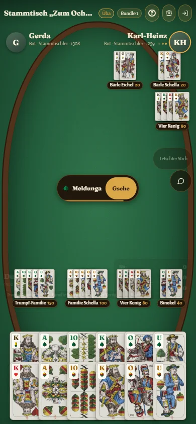

# Binokel Wirtshaus

**Das schwäbische Kartenspiel – gegen Bots oder online mit Freunden.**
*The Swabian card game – against bots or online with friends.* → [English below](#english)

  

## Herunterladen

| | |
|---|---|
| **Android** | [binokel.apk](https://github.com/AscendancyDotA/binokel/releases/download/latest-test/binokel.apk) – herunterladen, öffnen, „Installation aus unbekannten Quellen“ erlauben |
| **Windows** | [binokel-setup.exe](https://github.com/AscendancyDotA/binokel/releases/download/latest-test/binokel-setup.exe) – noch nicht signiert: bei SmartScreen „Weitere Informationen → Trotzdem ausführen“ |
| **Im Browser** | **<https://binokel.tail108204.ts.net>** – ohne Installation, auch als App installierbar |

Alle Versionen mit Änderungen: [Releases](https://github.com/AscendancyDotA/binokel/releases) (`latest-test` ist immer die neueste Test-Version).
Die Apps sagen selbst Bescheid, wenn es eine neue Version gibt.

## Was ist Binokel?

Binokel ist das schwäbische Wirtshaus-Kartenspiel mit dem württembergischen Blatt (Eichel, Grün, Herz, Schellen; 48 Karten, jede doppelt).
Wer am höchsten **reizt**, nimmt den **Dabb**, drückt Karten, sagt **Trumpf** an – und muss mit **Meldungen** (Familie, Binokel, Paare, Vierlinge …) und **Stichen** mindestens so viele Punkte holen, wie er gereizt hat. Oder er geht ab – oder wagt einen **Durch**.
Gespielt wird zu dritt oder zu viert (über Kreuz) bis 1000 oder 1500 Punkte.

## Was die App kann

- **Gegen Bots spielen – auch offline:** sechs Bot-Charaktere vom Lehrbua Lukas bis zur unschlagbaren Oma Berta, eine **geführte Lernpartie** und eine bebilderte **Regelhilfe**.
- **Online:** eigene Tische (gewertet oder Übung, öffentlich oder per Einladungslink), Bots füllen freie Plätze, **Wertung** je Spielerzahl, Zuschauen, Chat und Schnellsätze, **Sprach- und Videochat** am Tisch.
- **Stammtisch:** eigene Gruppe mit Einladungslink, Gruppentische und Gruppen-Rangliste.
- **Tagesblatt** (jeden Tag dieselben Karten für alle), **Wochen-Turnier** am Wochenende, **Ehre** und **Treue** statt Belohnungs-Druck – kein Geld, keine Werbung.
- **Wirtshaus-TV:** immer laufende Bot-Tische zum Zuschauen, mit offenen Karten.
- **Wiedergabe jeder Partie** mit **Partie-Auswertung**: welcher Zug war gut, wo wäre mehr dringewesen?
- **Hausregeln:** mit/ohne Siebener, Durch und Untendurch, Kein Dabb, Rufen, Tauschen, Runden-Limit, Min.-Wertung.
- Drei Looks (**Wirtshaus**, **Arena**, **Klar** mit hohem Kontrast), große Karten & Schrift, **Schwäbisch, Hochdeutsch und Englisch**.

<table>
  <tr>
    <td width="66%"> Meldungen kommen wie im Wirtshaus offen auf den Tisch.</td>
    <td rowspan="2" width="34%"> Auch hochkant auf dem Handy.</td>
  </tr>
  <tr>
    <td> Partie-Auswertung: Genauigkeit, Fehler und der bessere Zug.</td>
  </tr>
  <tr>
    <td> Wirtshaus-TV: Bots zuschauen, mit offenen Karten.</td>
    <td> Reizen – Kartenrücken und Tischtuch frei wählbar.</td>
  </tr>
</table>

## Fehler melden, Wünsche, Regelfragen

- **Am einfachsten in der App:** *Einstellungen → Über die App → Fehler melden* oder die kleine **Fahne** oben am Tisch bzw. in der Wiedergabe.
  Version, Gerät und Partie gehen automatisch mit; Bildschirmfoto und App-Protokoll nur, wenn du das Häkchen setzt.
  Daraus wird hier ein öffentlicher Eintrag – **ohne deinen Spielernamen und ohne IP-Adresse** (nur eine anonyme Kennung).
- **Oder hier auf GitHub** (mit eigenem GitHub-Konto): [Neuer Eintrag](https://github.com/AscendancyDotA/binokel/issues/new/choose) → *Fehler*, *Wunsch* oder *Regelfrage*.
- Vorher kurz schauen, ob es schon [gemeldet](https://github.com/AscendancyDotA/binokel/issues) ist – ein 👍 auf einem bestehenden Eintrag hilft auch.

## Datenschutz & Impressum

[Datenschutzerklärung](https://binokel.tail108204.ts.net/datenschutz) · [Impressum](https://binokel.tail108204.ts.net/impressum)
Kein Werbe-Tracking, keine Cookies, keine Analyse-Dienste. Gegen Bots kannst du ganz ohne Konto und ohne Verbindung spielen.

## Quellcode

Dieses Repository enthält **keinen Quellcode** – nur Downloads, Beschreibung und die Fehlermeldungen. Die Entwicklung läuft in einem privaten Repository.

## Danke

Kartenbilder: historische Scans des württembergischen Musters (Bibliothèque nationale de France) über Wikimedia Commons, **CC0** · Töne: [Kenney](https://kenney.nl), **CC0** · Farbsymbole: Wikimedia Commons, **CC BY-SA 4.0** · Schriften: **SIL Open Font License**. Einzelheiten: [CREDITS.md](CREDITS.md).

---

## English

**Binokel** is the traditional card game of Swabia (south-west Germany), played with the 48-card Württemberg pack: bid for the right to take the **Dabb** (widow), name **trumps**, score **melds** and **tricks** – at least as many points as you bid – or concede, or go for a **Durch** (all tricks).
Three players, or four in two teams, up to 1000 or 1500 points.

**Download:** [Android APK](https://github.com/AscendancyDotA/binokel/releases/download/latest-test/binokel.apk) · [Windows installer](https://github.com/AscendancyDotA/binokel/releases/download/latest-test/binokel-setup.exe) (unsigned: SmartScreen → *More info → Run anyway*) · **play in the browser: <https://binokel.tail108204.ts.net>** · [all releases](https://github.com/AscendancyDotA/binokel/releases)

**Features:** six bot characters, offline play, guided first game and illustrated rules · online tables (rated or practice), ratings, spectators, chat, voice & video · Stammtisch groups · daily deal, weekly tournament, honour and loyalty instead of pay-to-win – no money, no ads · Wirtshaus-TV (bot tables to watch) · replay of every match with move-by-move **analysis** · house rules · three looks incl. high contrast, big cards · Swabian, German and English.

**Report a problem / wish / rules question:** in the app via *Settings → About → Report a problem* or the small **flag** at the table and in the replay viewer – version, device and match are attached automatically, a screenshot and the app log only if you tick the box. It becomes a public issue here **without your player name or IP address**. Or open an [issue](https://github.com/AscendancyDotA/binokel/issues/new/choose) with your GitHub account.

**Privacy:** [privacy policy](https://binokel.tail108204.ts.net/datenschutz.html#en) · [legal notice](https://binokel.tail108204.ts.net/impressum.html#en). This repository contains **no source code**, only releases, this description and the issues.

**Credits:** card images CC0 (BnF via Wikimedia Commons), sounds CC0 (Kenney), suit symbols CC BY-SA 4.0, fonts SIL OFL – see [CREDITS.md](CREDITS.md).
